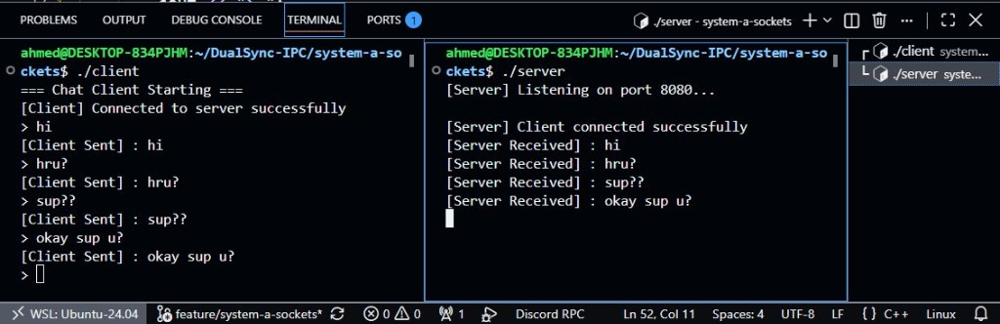

# DualSync-IPC

> A low-level dual-engine messaging suite in C++ exploring **TCP/IP Sockets with Multithreading** and **POSIX Shared Memory with Semaphore Synchronization**.

---

## 📌 Project Overview
DualSync-IPC is designed to explore and compare two fundamental Inter-Process Communication (IPC) paradigms in Unix-like operating systems:

1. **System A (Networked - Multi-threaded Sockets):** 
   * Client-Server architecture over TCP/IP (`socket`, `bind`, `listen`, `accept`, `connect`).
   * Concurrent multi-client communication using Threads (`std::thread` / `pthreads`).
   * Supports communication across different machines over the network.

2. **System B (Local - Synchronized Shared Memory):** 
   * Ultra-fast zero-copy local messaging using POSIX/System V Shared Memory (`shmget` / `shmat`).
   * Process synchronization and race-condition prevention via Semaphores (`sem_wait`, `sem_post`).
   * Operates between independent processes on the same machine.

3. **User Interface (Simple GUI):**
   * A clean graphical interface connecting to both messaging engines.

---

## 📸 Live Demonstrations

### System A: Interactive TCP Socket Communication (Terminal)
Real-time continuous message exchange between the TCP Client and Server processes running on `127.0.0.1:8080`:

<p align="center">
  
</p>

---

## 📂 Project Architecture
```text
DualSync-IPC/
├── system-a-sockets/       # Networked Chat Engine (Sockets + Threads)
├── system-b-shm/           # Local High-Speed Chat Engine (Shared Memory + Semaphores)
├── gui/                    # Simple Graphical Interface
└── docs/                   # Documentation, Screenshots, and Demo Video
    └── screenshots/        # Verified Terminal & GUI Execution Logs
```

---

## 🎓 Academic Context
* **Institution:** Egyptian E-Learning University (EELU) - Faculty of Computers & IT
* **Course:** Operating Systems (Fall 2026–2027)
* **Supervised by:** Dr. Wafaa Samy & Eng. Dyaa Elden Yahya
* **Project Team:**
  1. Ahmed Harby Makawy (Team Leader - Core Architecture)
  2. Andro Emil Nasry
  3. Ahmed Ali Ahmed
  4. Ahmed Saber Ahmed
  5. Fatma Ahmed Mohamed
